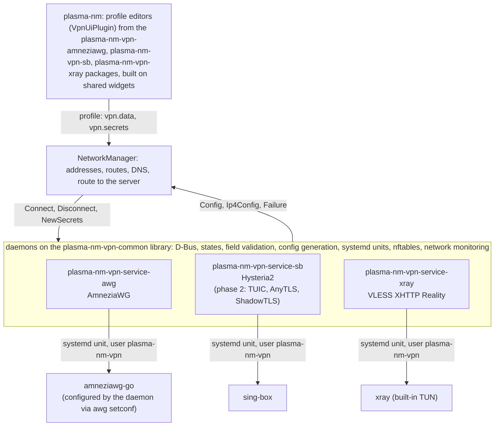

# Modern VPN protocols in NetworkManager and KDE: design and plan

22 November 2026 · Nikolay · revised 26 November 2026

## Goals and requirements

We need a set of NetworkManager plugins so that hysteria2, VLESS XHTTP Reality, AmneziaWG, TUIC, AnyTLS and ShadowTLS can be configured and enabled from the standard KDE interface (plasma-nm) without third-party applications. There is no such support out of the box: VPNs in NM are connected through plugins, each of which consists of a D-Bus daemon and a UI plugin for plasma-nm.

- **Open-source project:** the source code is on GitHub, and third-party users install it on their own machines. No telemetry and no network requests other than the connection to the VPN server, the liveness check through the tunnel (see “Core supervision and cleanup”) and (from phase 2) updates of subscriptions the user has added themselves.
- **Platform:** Debian forky (testing) and KDE Plasma 6; sid is supported along the way: the build from forky also works with the newer Qt and plasma-nm from sid. Other distributions are out of scope; only the packaging depends on Debian. Architecture: amd64 only; arm64 is not supported until there is something to test it on.
- **Minimum new dependencies:** only our packages are installed on users' machines (they also contain the tunnel core binaries); system libraries come from a standard Debian installation with KDE.
- **Everything through the UI:** no manual config editing; links and configs are imported with a button.
- **Distribution:** the project's signed public apt repository; profiles are moved between machines by importing links and files.
- **Localization:** UI strings in English, Russian translation via ki18n.
- **Routing** is configurable. IPv6 inside the tunnel is optional, but IPv6 traffic must not bypass the tunnel.
- **Leak protection:** with a default-route tunnel, DNS and IPv6 never bypass the tunnel; the kill switch is a per-profile option, off by default.
- **Security:** a profile created by an unprivileged user gives them neither root privileges nor access to other users' secrets.

## Threat model

The project is installed by third-party users on their own machines, so the assumptions are broader than for an in-house fleet.

- **The adversary is an ISP or censor with DPI:** it blocks addresses and recognizes protocols. Disguise is provided by the tunnel cores. The plugins are required to ensure that traffic which the profile sends through the tunnel never goes directly: not during normal operation, not on network changes, and (with the kill switch) not when the tunnel goes down.
- **A local unprivileged user** can create their own VPN profiles: polkit allows this by default. Users' machines may be multi-user. Everything written to a profile is untrusted data for the daemon, which runs as root.
- **Supply chain:** the project's repository, CI and signing key are an attractive target. Packages are installed as root and the daemons run as root, so compromising any link gives root on all users' machines. Mitigations are described in the section “Distribution and supply chain”.
- **Out of scope:** root on the machine, server compromise, application-level leaks, local inspection of the machine (presence of the package, interface and unit names).

## Scope

- **MVP:** AmneziaWG, Hysteria2, VLESS XHTTP Reality; IP-based routing via NM; import of links and `.conf`; DNS and IPv6 leak protection; kill switch.
- **Phase 2:** TUIC, AnyTLS, ShadowTLS (each as a separate entry in the “Add VPN” list); rule-based routing; IPv6 inside the tunnel; subscriptions with background updates; the AmneziaWG kernel module as an alternative to amneziawg-go; import of client JSON configs and `vpn://` from AmneziaVPN.

## Protocols and backends

The six protocols come down to three cores, and WireGuard needs no work: it is already built into NetworkManager.

| #  | Protocol            | Core               | Phase  | Notes                                                                      |
|----|---------------------|--------------------|--------|----------------------------------------------------------------------------|
| 01 | VLESS XHTTP Reality | xray               | MVP    | XHTTP exists only in xray; xray's built-in TUN inbound is used             |
| 02 | AmneziaWG (3.1)     | amneziawg-go + awg | MVP    | MVP: userspace only; the kernel module comes in phase 2                    |
| 03 | WireGuard           | stock NM           | —      | no plugin needed                                                           |
| 04 | Hysteria2           | sing-box           | MVP    | Salamander obfuscation, port hopping                                       |
| 05 | TUIC                | sing-box           | 2      |                                                                            |
| 06 | AnyTLS              | sing-box           | 2      |                                                                            |
| 07 | ShadowTLS           | sing-box           | 2      | in sing-box it is a wrapper: a chain of two outbounds                      |

According to the sing-box changelog (current stable version 1.14.5), all the required protocols are already there: ShadowTLS since 1.0, TUIC since 1.4, Hysteria2 since 1.5 (port hopping since 1.12), AnyTLS since 1.12.

NetworkManager-ssh was considered separately: a plain L3 tunnel via `ssh -w` without obfuscation; it is not suitable for circumventing blocking, but it works as a fallback and as an example of a finished NM plugin.

## Architecture

There is one plugin per core, and all the shared work is moved into a library, so three plugins do not mean three copies of the code. Each package ships its own core: if a package is not installed, its entry is not in the VPN list.

*WireGuard is not shown: it is built into NetworkManager, no plugin is needed.*

NM starts the daemon; the daemon validates the profile fields, generates the core config from them, starts the core and hands the connection parameters to NM. Addresses, routes and DNS are always set by NM; the daemon does not touch them.

- **Daemon language:** C with libnm (`NMVpnServicePlugin`, created with `NM_VPN_SERVICE_PLUGIN_DBUS_WATCH_PEER=TRUE`, so that the daemon notices a vanished NM and exits right after `STOPPED`). The base class itself implements the D-Bus interface, name registration, states and signals; all that remains is to override `connect`, `disconnect`, `need_secrets`. The stock plugins (openvpn, vpnc, openconnect) are written the same way. Go is needed only in CI, to build amneziawg-go, which has no binary releases (see “Packages”); the UI plugin is written in C++/Qt.
- **UI plugin:** C++/Qt 6 and KF6, a subclass of `VpnUiPlugin`.
- **Core launch:** via systemd (`StartTransientUnit` over D-Bus), unit `plasma-nm-vpn-core-<uuid>.service`. The core runs as the system user `plasma-nm-vpn` with only the capabilities it needs — `CAP_NET_ADMIN` for sing-box and amneziawg-go (they set the MTU and bring the TUN up), none for xray, which gets the TUN as a file descriptor — in a sandbox (`ProtectSystem=strict`, `ProtectHome`, `PrivateTmp`, `NoNewPrivileges`); no core needs `CAP_NET_RAW`, as binding a socket to the parent device is unprivileged (verified in 0.4). The unit stops the core with `KillSignal=SIGKILL`: a core must not clean up the TUN, which belongs to the daemon (see “Network changes and sleep”), so a stop takes the same path as a crash. The config is passed via `LoadCredential=`, so only the core user can read it. All cores of all profiles share this one user, so a core compromised by a malicious server could read the configs (including secrets) of other active profiles; this is accepted for the MVP (see the risks), and per-unit isolation (`DynamicUser=` with a cgroup-based kill switch exemption instead of `skuid`) is a phase 2 candidate. Logs go to the unit's journal. The cores' official units also run without root: Xray-install uses a dedicated user `xray` with `CAP_NET_ADMIN CAP_NET_BIND_SERVICE CAP_NET_RAW`, and sing-box 1.14.4 uses the user `sing-box` with ambient capabilities.
- **Core lifetime is bound to the daemon.** On `Connect` (the profile UUID only becomes known there), the daemon moves itself into its own transient scope (`plasma-nm-vpn-daemon-<uuid>.scope`), and both the core unit and a small guard unit get `BindsTo=` and `After=` on that scope. If the daemon exits in any way, including a crash, the scope becomes empty: systemd stops the core by itself, and the guard unit runs the cleanup (see “Core supervision and cleanup”). Without this, after a daemon crash the core would keep running and the nftables chains would stay until someone started the profile again.
- **The daemon reports the TUN name to NM** (`NM_VPN_PLUGIN_CONFIG_TUNDEV`): NM sets addresses and routes on this interface and, when the parent device changes, moves the route to the gateway (only for VPNs with a TUN).
- **amneziawg-go:** the UAPI socket directory `/run/amneziawg` is hardcoded in both amneziawg-go and `awg`. So `plasma-nm-vpn-amneziawg` creates it via tmpfiles.d with owner `plasma-nm-vpn`. `RuntimeDirectory=` does not fit: the directory is shared by all connections, and systemd would delete it as soon as the first unit stops. With `ProtectSystem=strict`, the directory is made writable via `ReadWritePaths=/run/amneziawg`. The daemon (root) configures the interface via `awg setconf`; root is able to connect to the socket. amneziawg-go runs in the foreground (`-f`). A `SIGKILL` leaves its socket behind; a new instance replaces it, but the daemon removes it before the start and waits for the new socket before `awg setconf`, so that `awg` never talks to the stale one (it then falls back to the kernel interface and fails with “Protocol not supported”).
- **Multiple connections:** `.name` sets `supports-multiple-connections=true`; NM starts a separate daemon instance for each connection and passes it `--bus-name <service>.Connection_<N>`. The D-Bus policy allows `own_prefix` on the service name. The TUN name is `pnv-` plus 8 characters of the profile UUID.
- **Names must match:** the service-type in `.nmconnection`, `service` in `.name`, the daemon's D-Bus name and the `X-NetworkManager-Services` key in the UI plugin metadata; otherwise plasma-nm will not link the editor to the daemon. A separate `backend` key is not needed: the core is determined by the service-type.
- **Service names follow the protocol, not the core:** `org.freedesktop.NetworkManager.pnv.hysteria2`, `org.freedesktop.NetworkManager.pnv.vless`, `org.freedesktop.NetworkManager.pnv.amneziawg`; in phase 2, `.pnv.tuic`, `.pnv.anytls`, `.pnv.shadowtls`. These names end up in `.nmconnection` and cannot be changed later without breaking profiles. So they do not depend on the core: if a protocol moves to another core, profiles keep working. As a side benefit, the sing-box name does not appear in identifiers visible to the system. The core unit is named by UUID, without the core name.
- **Paths:** daemons — `/usr/lib/plasma-nm-vpn/plasma-nm-vpn-service-{sb,xray,awg}` (the core abbreviations are the same as in the package version suffix); the auth dialog — `/usr/lib/plasma-nm-vpn/plasma-nm-vpn-auth-dialog` (in `plasma-nm-vpn-common`, named in each `.name` under `[GNOME]` with `supports-external-ui-mode=true`; it only tells nmcli and other agents that support the mode which secrets the service type needs, from the same table as the daemons' `need_secrets`, so `nmcli --ask` and `passwd-file` work; nmcli knows the secrets of no third-party plugin without one (2.1); plasma-nm ignores it and asks via `VpnUiPlugin`); the TUN helper — `/usr/lib/plasma-nm-vpn/plasma-nm-vpn-tun-fd NAME VAR COMMAND…` (in `plasma-nm-vpn-common`, 4.2: attaches to the persistent TUN as its owner, puts it on fd 3, sets `VAR=3` and execs the core; xray's core unit runs `plasma-nm-vpn-tun-fd pnv-… XRAY_TUN_FD /usr/lib/plasma-nm-vpn/bin/xray run -c …` with no capabilities); the guard tool — `/usr/bin/plasma-nm-vpn-guard` (users run `--clear`); `/run/plasma-nm-vpn/` itself — 0755 (via tmpfiles.d, so that `guard-status` is reachable); generated core config — `/run/plasma-nm-vpn/<uuid>/` (root, 0700; the source for `LoadCredential=`); block status file — `/run/plasma-nm-vpn/guard-status` (world-readable, see “Leak protection”); cached server IPs — `/var/lib/plasma-nm-vpn/<uuid>`; address pool settings — `/etc/plasma-nm-vpn/plasma-nm-vpn.conf`; config templates, allowlists and nftables templates — `/usr/share/plasma-nm-vpn/`.
- **sing-box protocols are separate entries in the “Add VPN” list:** each protocol has its own `.name` with its own `service`, and they all point to the same daemon binary (NM checks that the name and `service` are unique, but not `program`). The daemon determines the protocol from `vpn.service-type` in the settings received in `Connect`. A `protocol` key in `vpn.data` is therefore not needed.

## Packages

| Package | Contents | Dependencies |
|-------|------------|-------------|
| `plasma-nm-vpn` | metapackage: installs all core packages, and in phase 2 the new ones too | all core packages (`plasma-nm-vpn-common` comes in through them) |
| `plasma-nm-vpn-archive-keyring` | repository signing key and the source file `/etc/apt/sources.list.d/plasma-nm-vpn.sources` with `Signed-By` | — |
| `plasma-nm-vpn-common` | shared daemon library; shared editor widgets (Qt/KF6, without plasma-nm's internal API); the `plasma-nm-vpn` user; nftables templates; `plasma-nm-vpn-guard` and its polkit action; the helper that hands a core its TUN as a file descriptor | `network-manager`, `nftables`, `pkexec` |
| `plasma-nm-vpn-sb`, `plasma-nm-vpn-xray`, `plasma-nm-vpn-amneziawg` | core binary in `/usr/lib/plasma-nm-vpn/bin/`, daemon, `.name`, editors (`VpnUiPlugin`), config templates and key allowlists for this core version | `plasma-nm-vpn-common (= <project version>)` (the shared library is private); `plasma-nm (>= 4:6.0), plasma-nm (<< 4:7)` |

The new packages add almost no system dependencies. nftables has priority `important` and is present in any Debian installation, and json-glib (for JSON generation in the daemons) is pulled in by `xdg-desktop-portal`, which is mandatory for KDE (verified on forky). `pkexec` is a small separate package split out of polkit, and a stock forky KDE install (`task-kde-desktop`) does not have it (checked on 2026-11-27, milestone 0.2), so it is the one new system dependency.

**Removal and upgrades.** On `remove` (not on `upgrade`), the `prerm` of a core package deactivates that package's active VPN connections and waits up to 20 s for their daemon scopes to go away (then warns and continues, so removal is never blocked), and the `prerm` of `plasma-nm-vpn-common` also removes all of our nftables chains and `guard-status`, so that removing the packages never leaves a block without a tool to clear it. An upgrade does not touch running connections: the run-directory markers and the `guard-status` format carry a version, and the new code reads the previous one. A core update is an ordinary new project version (for example `0.1.1` with sing-box 1.14.5, so the package becomes `0.1.1+sb1.14.5`): every package gets the new version, the release name says that something changed, and the release notes list the core versions. Releases are tagged `v<version>` on `master`, or on a release branch `release/<x.y>` for a fix to an older version; `scripts/check-tag` checks the tag against `debian/changelog` and the branch. (1.3 first rehearsed core-only releases that kept the project version; dropped, since such a release could not be told from the previous one by its name.)

One package, one core: the user installs `plasma-nm-vpn-sb` and gets the core, the daemon and the editors for all protocols that the package supports in its current version. The list of protocols is given in the package description. A core package's version is the project version plus a core suffix: `0.1.0+sb1.14.5`, `0.1.0+xray26.11.9`, `0.1.0+awg3.1.20261116` (based on the amneziawg-go tag; the `awg` version is given in the changelog). `plasma-nm-vpn-common`, the metapackage and `plasma-nm-vpn-archive-keyring` have just the project version. On purge, the system user `plasma-nm-vpn` is not removed, as is customary in Debian. Installation: download `plasma-nm-vpn-archive-keyring` from the GitHub release page, install it, then run `apt install plasma-nm-vpn` to get everything at once, or install individual core packages.

- **plasma-nm compatibility:** the `VpnUiPlugin` API is internal (there are no headers in Debian, and `libplasmanm_editor.so` has no version in its SONAME), but it is stable in practice. The headers the plugin needs (`vpnuiplugin.h`, `settingwidget.h`, `passwordfield.h`) have not changed ABI even once from 6.0.0 to 6.8.3; the only change across the series was a clang-format reformatting. Therefore:
  - one editor build per release, installed directly into plasma-nm's plugin directory (`qt6/plugins/plasma/network/vpn/`);
  - the dependency `plasma-nm (>= 4:6.0), plasma-nm (<< 4:7)`: plasma-nm updates within 6.x do not remove the packages, and there is no `apt autoremove` cascade;
  - the real compatibility constraint is the Qt version: Qt rejects a plugin built against a newer minor Qt version than the installed one. The build runs in a forky environment, and the packages get an explicit `libqt6core6t64 (>= <the Qt version used for the build>)` via a substvar computed at build time: `dpkg-shlibdeps` derives versions from the symbols used and would allow an older Qt that then rejects the plugin;
  - CI on GitHub Actions tracks plasma-nm in sid and compares the plugin headers with those the release was built against. If they have changed, the build is fixed before the new plasma-nm reaches forky. plasma-nm has no autopkgtest, so migration from sid takes about 5 days (urgency medium);
  - after a package update, kded6 and systemsettings keep the old plugin in memory until they are restarted or the user logs in again (the applet in plasmashell reads only the metadata).

  The shared widgets in `plasma-nm-vpn-common` do not use the internal API and are not tied to the plasma-nm version.
- **Where the cores come from** (provenance verification is covered in the section “Distribution and supply chain”):
  - sing-box and xray: repackaging of upstream releases (`sing-box-<version>-linux-amd64.tar.gz`, `Xray-linux-64.zip`);
  - amneziawg-go publishes no binary releases, only tags. It is built in CI from a pinned tag (currently `v3.1.20261116`, which supports AWG 3.1);
  - `awg` from amneziawg-tools is also built from a tag (`v3.1.20260812`) in a forky environment: the upstream prebuilt archives are built on Ubuntu 22.04.

  The path `/usr/lib/plasma-nm-vpn/bin/` does not conflict with manually installed binaries.
- **Core updates:** a new core version → a new project version (see “Removal and upgrades”): CI builds all packages and runs the integration tests (see “Testing”) → publication to the project repository. Config templates and key allowlists live in the same package as the binary, so they cannot drift apart from it. Security fixes in the cores are released out of band.

## Distribution and supply chain

- **Repository:** a flat apt repository in the release assets of the latest GitHub release; there is no separate hosting. In each release, CI uploads all current packages (including unchanged ones), plus `Packages` and an `InRelease` signed with the project key. Source: `URIs: https://github.com/alldevic/plasma-nm-vpn/releases/latest/download/`, `Suites: ./`, no `Components`; apt follows GitHub's redirect to the file storage. Old versions are available only on the pages of previous releases; rolling back via apt is not possible. freelens, openvpn-auth-oauth2 and Jamulus are already distributed this way; apt on forky handles the redirect chain to `release-assets.githubusercontent.com` (the query string problem existed only in old apt, before 2.2). Rules:
  - a release is created as a draft, all files are uploaded to it, and only then is it published: otherwise clients would see an inconsistent index;
  - unchanged packages are not rebuilt but taken from the previous release, with their sha256 checked against the previous `Packages`: a package with the same version but different contents breaks apt clients;
  - release rehearsals take place in a separate test repository (`alldevic/plasma-nm-vpn-test`, created in 0.9) with a test key (ed25519, fingerprint `50C0E22E388A3E4540E4997BE846F285ECEFDFAE`, not the project key), because any published release of the main repository immediately becomes `latest`; this is why the URI in the `.sources` file of the `plasma-nm-vpn-archive-keyring` package is filled in at build time from the repository name;
  - GitHub renames assets with special characters: `~` becomes `.`, `+` is kept (0.9). The asset name is the `.deb` file name with both `+` and `~` replaced by `-` (`pnv-apt-test_0.1.0-sb1.14.4_all.deb`; the version inside the package is unchanged), and `Filename:` in `Packages` is that name;
  - `Acquire-By-Hash` is not enabled: release assets cannot contain directories. The index is published as both `Packages` and `Packages.xz` (0.9): apt fetches `Packages.xz` and falls back to `Packages` without an error if the `.xz` is missing; the uncompressed file is what the release pipeline reads from the previous release and checks against its `InRelease`. Generation: `apt-ftparchive packages .` (with the `./` prefix stripped from `Filename:`), `xz -k Packages`, `apt-ftparchive release .` written outside the release directory (otherwise it lists itself), `gpg --clearsign -o InRelease`; only `InRelease` is published, no `Release`;
  - for about two minutes after a release is published, apt may still be redirected to the previous release: GitHub's edge caches the `latest/download/<file>` redirect per file and keyed by the `Accept` header (`Vary: Accept`; apt sends `Accept: text/*`). A client inside that window can get `InRelease` of the new release and `Packages.xz` of the old one, and `apt update` then fails once with “Hash Sum mismatch”; the next run after the window succeeds (0.9: the window lasted about 2 minutes). This is accepted and noted in the README;
  - a published `InRelease` with a wrong signature can stick on clients: apt keeps the rejected file in `lists/partial/` and resumes it with `Range`/`If-Range`; when the next good `InRelease` has the same size (likely: the ed25519 signature, the hashes and the date have fixed lengths), the server answers 416 and apt checks the stale file again. Neither deleting the bad release nor publishing a newer one recovered such a client in 0.9; only `rm /var/lib/apt/lists/partial/*plasma-nm-vpn*` did. So the pipeline verifies `InRelease` against the published keyring (`gpgv`) before publishing, and the README carries the recovery command;
  - GitHub limits: files up to 2 GiB, up to 1000 assets per release; total size and traffic are unlimited.

  The key is rotated by updating the `plasma-nm-vpn-archive-keyring` package. The project key (ed25519, fingerprint `A3E769061D67827D850B39031816D0F3C97A11CD`, expires 2029-11-26) was created outside CI in 1.3; its private part exists only as the secret `SIGNING_KEY` of the Environment `release` (required reviewer, deployments only from `v*` tags) and in the maintainer's offline backup. The keyring package takes the key of the repository it is built for (`data/keyring/<repository name>.gpg`), so the test repository's releases carry the test key.
- **CI on GitHub Actions:** third-party actions are pinned by commit SHA, and `GITHUB_TOKEN` has minimal permissions. Builds from pull requests get no secrets. Signing is done by a separate job in a GitHub Environment with manual approval; only that job has access to the key. Build provenance attestations are published for the .deb files (GitHub artifact attestations).
- **Cores:** the sha256 of each upstream archive is recorded in the project repository, and any change to it goes through review like ordinary code. In addition, the archive is checked against what upstream publishes: for xray these are the `.dgst` files (SHA2-256 and SHA2-512). sing-box publishes no separate checksums, so the asset `digest` from the GitHub API is used. Cores built from source are pinned by the tag's commit hash. The pins live in `cores/*.env` (one file per core: version and asset sha256, or tag and commit); `scripts/fetch-cores` downloads or builds the cores before the package build, which then runs offline (1.2).
- **Core licenses** (checked against the LICENSE files in the upstream repositories): each core is distributed under its own license. For GPL cores, the sources of the same version together with their Go dependencies (`go mod vendor`) are published next to the binary, so that the archive is the complete corresponding source code. The additional sing-box term, verbatim: “In addition, no derivative work may use the name or imply association with this application without prior consent”.

  | Core | License | What to do |
  |------|----------|-------------|
  | sing-box | GPL-3.0-or-later with an additional term on use of the name | publish the sources; our package is named `plasma-nm-vpn-sb` and none of our identifiers contains “sing-box”; the core is named only in the package description and the license information (attribution the GPL requires, not a claim of association); the core binary and the GPL source archive keep their upstream names |
  | xray | MPL-2.0 | state the license and link to the sources |
  | amneziawg-go | MIT | state the license |
  | awg (amneziawg-tools) | GPL-2.0 | publish the sources |

- **Project license:** MIT. It is GPL-compatible, so the editors can be linked against plasma-nm's internal library, which is distributed under the GPL. The built editor together with that library forms a combined work under the GPL; the project's sources remain under MIT.
- **Vulnerabilities:** the daemons run as root, so almost any bug in them means local privilege escalation. The repository has a `SECURITY.md`, and reports are accepted via private GitHub Security Advisories.

## Profile data schema

A profile stores typed fields, not a ready-made config. The daemon generates the core config from the fields using a template for the pinned core version. This way secrets do not end up in `vpn.data`, the daemon does not execute an arbitrary config as root, and a core update changes the template but not the profiles.

Common `vpn.data` keys:

| Key | Purpose |
|------|------------|
| `schema` | profile schema version; the daemon understands all past versions, and the editor migrates the profile to the current one on save |
| `server`, `port` | server host or IP and port (Hysteria2 uses `ports` instead of `port`) |
| `dns` | tunnel DNS servers. If the field is empty and the tunnel is a default-route tunnel, the daemon uses `1.1.1.1` (Cloudflare) and `9.9.9.9` (Quad9) for every protocol; with never-default, no defaults are passed (see “DNS”). For AmneziaWG the importer fills the field from the `.conf` |
| `kill-switch` | `yes`/`no`, default `no` |
| `allow-lan` | `yes`/`no`, default `yes`: with the kill switch, local networks (RFC 1918, link-local) remain reachable |
| `mtu` | optional |
| `extra` | JSON, sing-box and xray only: merged only into the outbound object; keys are checked against an allowlist |

Protocol keys:

| Protocol | `vpn.data` | `vpn.secrets` |
|----------|------------|---------------|
| Hysteria2 | `ports` (ports in link format: `443` or `443,5000-6000`; the daemon converts them to sing-box format), `hop-interval`, `obfs` (`salamander` or empty), `tls-sni`, `tls-alpn`, `tls-insecure`, `tls-pin-sha256`, `up-mbps`, `down-mbps` | `password`, `obfs-password` |
| VLESS XHTTP Reality | `encryption` (`none` or a VLESS Encryption ML-KEM key), `reality-pbk`, `reality-sid`, `reality-spx`, `tls-sni`, `tls-fingerprint`, `xhttp-mode`, `xhttp-path`, `xhttp-host`, `xhttp-extra` (JSON, allowlist) | `uuid` |
| AmneziaWG | `address`, `peer-public-key`, `allowed-ips`, `keepalive`, `awg-<parameter>` for AmneziaWG parameters (Jc, Jmin, Jmax, S1–S4, H1–H4, I1–I5; from AWG 3.0: ContentPaddingAddition, rekey/keepalive timings, MaxHandshakeAttempts; from 3.1: RandomTrailers, DisableCookies) | `private-key`, `preshared-key`, `awg-headerprotectionkey` |

The list of allowed AmneziaWG parameters is data in the `plasma-nm-vpn-amneziawg` package, not code: a new parameter is added by updating the list together with the amneziawg-go version. The editor shows them as a key–value table restricted to this list. `HeaderProtectionKey` is not part of the table: it is a secret and has its own field.

AmneziaWG rules in the MVP:
- one `[Peer]` is supported; a `.conf` with several is rejected on import with a clear error;
- the first IPv4 address is taken from `Address` (`Ip4Config` holds only one), and the rest are dropped with a warning; IPv6 addresses and IPv6 entries in `AllowedIPs` are dropped, because IPv6 in the tunnel is phase 2;
- `0.0.0.0/1` + `128.0.0.0/1` in `AllowedIPs` are normalized to `0.0.0.0/0` by the shared validator library (so the importer, the editor and the daemon all treat them alike). The tunnel is considered a default-route tunnel if `AllowedIPs` contains `0.0.0.0/0` and never-default is not enabled; the DNS and IPv6 guard and the kill switch depend on this. Otherwise the daemon passes `NM_VPN_PLUGIN_IP4_CONFIG_NEVER_DEFAULT=true` and only the narrower `AllowedIPs` as routes, because NM would otherwise put a default route through any VPN;
- if the `.conf` has no `DNS`, the importer leaves `dns` empty; when the tunnel is a default-route tunnel, the daemon then uses the same defaults as for the proxy cores (with never-default, no DNS is passed).

**Secrets** are stored the standard plasma-nm way (the `PasswordField` widget, `<key>-flags` flags in `vpn.data`): for each field you can choose “Store password for this user only (encrypted)” (the default when a keychain is available; since 6.7 plasma-nm stores them via QtKeychain in KWallet or Secret Service, and without a keychain `PasswordField` defaults to the next option), “Store password for all users (not encrypted)” (in the profile file, root, 600) or “Ask for this password every time”; optional secrets (`obfs-password`, `preshared-key`, `awg-headerprotectionkey`) also offer “Not required” (`NotRequired`), so that an empty optional secret does not trigger a prompt. The daemon implements `need_secrets` for each protocol. The plasma-nm agent hands over stored secrets without loading the editor; the editor is needed only for an interactive prompt (“Ask for this password every time”, wrong password). Import puts the secrets from a link into `vpn.secrets`; export includes secrets only when explicitly chosen.

**`tls-pin-sha256`** stays in the schema, so that a profile carrying it is recognised and refused with a clear reason. But the sing-box generator rejects any Hysteria2 profile that sets it (2.5): sing-box 1.14 can pin only a public key (`certificate_public_key_sha256`, reachable through `extra`), not the certificate hash that Hysteria2's `pinSHA256` means. The editor has no pin field (6.1), and import refuses a link with `pinSHA256` (6.6).

**Validation** (2.2) is the library `common/profile` (GLib and json-glib only, so the editors and the import parsers link it too):
- `pnv_profile_parse()` turns `vpn.data` + `vpn.secrets` into a typed `PnvProfile` or one `PnvProblem`, and the config generators read only the structure.
- Unknown `vpn.data` keys (other than `<secret>-flags`, 0–7) and unknown `vpn.secrets` keys reject the profile, naming the key; compatibility with fields added later is what `schema` is for.
- A profile without `schema` is schema 1 (profiles written by hand with nmcli); a newer schema is rejected before anything else, and migrations from older ones run in place (none yet).
- Every value, secrets included, must be valid UTF-8 without C0/C1 control characters or U+2028/U+2029; values have length limits. An empty value is the same as an absent one.
- A problem is a stable code (`PnvCode`, append-only) plus the key, a JSON path, a position and limits; it never carries a value. The daemon writes `pnv_problem_describe()` to the journal (names escaped and cut at 64 characters); the editors render the code through ki18n.
- `extra` is a JSON object of at most 8 KiB and 8 levels. Every member path (`tls.fragment`) must be on the core version's allowlist; arrays hold scalars only; strings follow the common rule after unescaping; `detour`, `path` and `*_path` are refused even if a list names them.
- **List files** (allowlists and the value lists for the forms) are `/usr/share/plasma-nm-vpn/<core>/<name>.list`, installed by the core package: UTF-8, one entry of `[A-Za-z0-9_.-]` per line, optionally followed by space-separated fields of `[A-Za-z0-9_.:-]`, `#` comments and blank lines skipped. An entry may end in a `.*` segment, which allows any member name at that level of a JSON allowlist (the XHTTP `headers.*`, 4.1). A protocol's list files are merged into one list, each under a prefix (`extra/`, `xhttp-extra/`, `awg/`, `tls-fingerprint/`, `xhttp-mode/`), and each schema field looks up its keys or values under its own prefix (4.1). The AmneziaWG allowlist (`amneziawg/amneziawg-params.list`, 3.1) uses the fields: `awg-<parameter> <awg config key> <type>`, with the types `uint16`, `u16range`/`u32range` (`N` or `N-M`), `onoff` and `chain` (I1–I5: printable ASCII without `#`, `=`, `[`, `]`).
- Fuzzing: libFuzzer targets for the profile parser and for `extra` (`tests/fuzz`, `-DPNV_FUZZ=ON` with clang, ASan and UBSan), run weekly for 30 minutes each by `.github/workflows/fuzz.yml`, with the corpus kept in the Actions cache.

## Daemon security

- Only the config generated by the daemon reaches the core; text from the profile is never passed through as a whole.
- `awg-quick` is not used. wg-quick keys (`PreUp`, `PostUp`, `PreDown`, `PostDown`, `SaveConfig`, `Table`) are dropped with a warning when importing a `.conf`; `Address`, `DNS`, `MTU`, `Endpoint` are parsed into fields. The config for `awg setconf` is generated by the daemon.
- All fields are validated: host and IP format, port ranges, base64 keys, lengths; control characters and line breaks are forbidden (the lesson of CVE-2018-10900 in NetworkManager-vpnc).
- `extra` and `xhttp-extra` go through a key allowlist for the core version. Keys with file paths, `detour` and anything outside the outbound are forbidden.
- The cores run without root (see “Architecture”).
- The import parsers and the daemon validators are covered by fuzzing.

## plasma-nm user interface

The “everything through the UI” requirement means structured forms, not a field for raw JSON: links and configs are pasted via import in the editor (see below). To avoid writing a separate form for each protocol, forms are assembled from shared blocks. The form fields are the source of truth: both the profile and the export are built from them.

| Block                                       | Where needed                          |
|---------------------------------------------|---------------------------------------|
| Server, port                                | all                                   |
| TLS (SNI, ALPN, insecure; fingerprint only for protocols over TCP; no pin field, see “Profile data schema”) | Hysteria2; in phase 2 TUIC, AnyTLS, ShadowTLS |
| Reality (SNI, pbk, sid, spx, fp)            | VLESS (lives in the VLESS editor)     |
| XHTTP transport (mode, path, host, extra)   | VLESS (lives in the VLESS editor)     |
| Obfuscation (Salamander), port hopping      | Hysteria2                             |
| Authentication (password or UUID)           | all except AmneziaWG                  |
| Interface and Peer, obfuscation parameters  | AmneziaWG                             |
| Protection: kill switch, local network, DNS | all                                   |
| Advanced: MTU                               | all                                   |
| Advanced: additional parameters (JSON)      | sing-box, xray                        |

The shared blocks in `plasma-nm-vpn-common` do not use plasma-nm's internal API. So `PasswordField` (which comes from `libplasmanm_editor.so`) is created by the editor in the core package and passed to the authentication block. The “Reality”, “XHTTP transport”, “Obfuscation, port hopping” and “Interface and Peer” blocks are each needed by only one protocol and live in that protocol's editor rather than among the shared ones. Value lists for the forms (TLS fingerprints, XHTTP modes) are data shipped with the core package next to the allowlists. Form validation calls the same 2.2 validator library as the daemon, allowlists included, so that the form and the daemon reject the same things. The import parsers and validators are C/GLib code without ki18n: they return message codes with parameters, and the editors render them through ki18n.

Import is built into our editor: the “Paste link or config” field and the “Open file” button fill in the form. plasma-nm's “Import VPN connection” in the plasma-nm settings cannot be relied on, for two reasons. It works only with files, without the clipboard or links. And the file goes to the first plugin that claims the extension: `.conf` is claimed by WireGuard and OpenVPN, so it would never reach AmneziaWG. In addition, this import loads all VPN plugins, so our plugin must survive being loaded in someone else's scenario without side effects.

MVP formats:

- `hysteria2://` and `hy2://` per the [official Hysteria2 URI scheme](https://v2.hysteria.network/docs/developers/URI-Scheme/): `auth@host:ports` with multiple ports (`443,5000-6000`), `obfs`, `obfs-password`, `sni`, `insecure`, `pinSHA256`. The `gecko` obfuscation, the `ech` parameter and the `hysteria2+realm://` variant are not supported in the MVP: import reports this. sing-box has no equivalent of `pinSHA256` (2.5: sing-box 1.14 has only `certificate_public_key_sha256`, a pin of the public key, while `pinSHA256` hashes the certificate), so a link with it is rejected the same way rather than imported without the pin;
- `vless://` per the XTLS link standard ([Xray-core #716](https://github.com/XTLS/Xray-core/discussions/716)): `type=xhttp`, `security=reality`, `encryption`, `pbk`, `sid`, `spx`, `fp`, `sni`, `path`, `host`, `mode`, `extra`. `allowInsecure` has been removed from Xray-core, and the standard has `pcs` and `vcn` instead; they are not needed for Reality;
- AmneziaWG `.conf` (awg-quick format, including files from AmneziaVPN).

Parameters that are not in the form are shown as a list on import: allowed ones go into `extra`, and the rest are dropped with a warning. Export is the “Export” button in our editor, to the same formats; whatever the link format cannot carry is lost, and the editor warns about it. Our plugin does not support plasma-nm's stock import and export: `supportedFileExtensions()` returns an empty list, and `suggestedFileName()` an empty string.

The `uuid` field is masked like a password (`PasswordField` with `setPasswordModeEnabled(true)`, as for every secret field). The VLESS editor also has an `encryption` field (default `none`), so that an imported ML-KEM value survives save and export. The editor writes `vpn.persistent=yes` (`VpnSetting::setPersistent`) on every save, not only for a new profile: plasma-nm replaces the whole `vpn` setting with what the plugin returns, so a value not written on re-save would be lost. A VPN plugin cannot set `ipv4.*` settings: plasma-nm builds them with its IPv4 tab, and the plugin returns only the `vpn` setting. So DNS with a default-route tunnel is handled without them (see “DNS”).

The editor plugin is implemented as a `VpnUiPlugin` (KPluginFactory in plasma-nm). The `vpn/openvpn` and `vpn/sstp` directories and the WireGuard editor in `libs/editor/settings/wireguard*` of the plasma-nm sources serve as examples.

- **Build:** the headers `vpnuiplugin.h`, `settingwidget.h` and `passwordfield.h` (LGPL) are copied into the repository from a plasma-nm tag, and we write our own `plasmanm_editor_export.h`. Linking is only against `libplasmanm_editor.so`. Plus NetworkManagerQt, KF6CoreAddons, KF6WidgetsAddons, KF6I18n, Qt6 Widgets and the libnm headers (`vpnuiplugin.h` includes `nm-connection.h`). Confirmed in 0.8 against plasma-nm 6.7.4 in forky: the library is the unversioned `/usr/lib/<triplet>/libplasmanm_editor.so` from `plasma-nm` itself, every plasma-nm symbol of the module resolves from it, and the module is installed with ECM's `KDE_INSTALL_USE_QT_SYS_PATHS=ON` (otherwise it lands outside Qt's plugin path).
- **Shared blocks (6.1):** `libpnv-widgets.so`, a private library of `plasma-nm-vpn-common` in `/usr/lib/<triplet>/plasma-nm-vpn/` (no SONAME: the core packages depend on `plasma-nm-vpn-common` at the exact version, and the editors find it by RUNPATH). It links Qt6 Widgets, KF6I18n and the static `common/profile`, and not `libplasmanm_editor.so`. Each block (`PnvBlock`) loads and writes its own `vpn.data` keys of an `NMStringMap` and checks every field with `pnv_check_field()`, list files included; the problems show under the block as rendered messages. A block writes `yes`/`no` for its checkboxes and drops empty fields. The library and everything that includes it builds with `QT_NO_KEYWORDS`, since GLib's headers have members named `signals`. The JSON metadata of an editor comes from `pnv_editor_metadata()` (`cmake/PnvEditor.cmake`).
- **Translations:** UI strings go through ki18n, and the `.pot` file is extracted KDE-style (a `Messages.sh`-like script running xgettext with the ki18n keywords); ki18n does not translate the plugin's JSON metadata, so `Name[ru]` and `Description[ru]` are written into it by hand.
- **Packaging:** the private library has no shlibs information, so `dpkg-shlibdeps` is run with missing data ignored, and `plasma-nm` is listed in `Depends` manually.
- **Discovery:** plasma-nm finds the plugin via `KPluginMetaData::findPlugins("plasma/network/vpn")` by the `X-NetworkManager-Services` key in the JSON metadata. Verified in 0.8 with no `.name` file installed: the “Add VPN” list comes from the plugin metadata alone (with `Name[ru]` in a Russian session), and the editor saves and reloads a profile; NM keeps a profile whose service has no `.name`. The editor tab is labelled with the last component of the service name (“VPN (hysteria2)”).
- **Who loads the plugin:** systemsettings, when editing, and also on stock import and export, where our plugin only declines; kded6, only for an interactive password prompt. The applet reads only the metadata.

plasma-nm version compatibility is described in the section “Packages”.

## Routing, DNS and IPv6

NetworkManager is the sole owner of addresses, routes and DNS, in every mode. sing-box runs with `auto_route: false`, xray's TUN runs without routes, and AmneziaWG's `AllowedIPs` are passed to NM as routes.

### Modes

1. **IP-based, via NetworkManager (MVP).** The IPv4 tab in plasma-nm (never-default, custom routes) works as for any VPN.
2. **Rule-based (phase 2).** NM sets the default route via the TUN, and the core decides “direct or via proxy” by domains and geoip; direct traffic goes out bound to the VPN's parent device. The mode suits both sing-box and xray: both have routing.

### Route to the server

Implementation (2.4):
- The cache file `/var/lib/plasma-nm-vpn/<uuid>` is a GLib key file, `[server]` `name=` (the profile's `server`) and `ip=`.
- The session's IP is also kept as `server-ip` in the run directory.
- A and AAAA are looked up in parallel within 5 s; an A answer decides at once.
- Temporary failures are retried within those 5 s; “no such name” for both A and AAAA is final.
- The parent device is the first entry of `nm_active_connection_get_devices()` on the profile's VPN active connection (the newest one with its UUID). It is the device the VPN runs over (`stand-cli` on the bench).

- The daemon resolves the server name with the system resolver before the tunnel comes up, picks one IP (IPv4 preferred; IPv6 only if the server has no A record) and passes exactly that IP to the core; SNI and Host remain the name. The IP is saved in `/var/lib/plasma-nm-vpn/<uuid>` only after the session succeeds (see “Leak protection”), so that a wrong or spoofed resolution never overwrites a known-good IP. The name is resolved again only on a fresh connect while this profile has no leftover kill switch chains; if resolution fails (for example, another profile's kill switch chains block DNS), the cached server IP is used. On reconnect the session's server IP (kept in the run directory) is used, and when this profile's kill switch chains remain after a failure the cached server IP is used right away: at that moment the default route and DNS still point into the non-working tunnel, and the kill switch blocks requests that bypass it. If the server has changed its IP, such a connection will fail; how the user learns about the block and clears it is described in the section “Leak protection”. Files of deleted profiles are cleaned up by tmpfiles.d based on the modification time (`m:90d`; the daemon refreshes the file on every successful connection). The daemon does not reconcile the cache with NM's profile list: profiles can change while NM is down, and the age rule is simpler. The cache file stores the `server` value next to the IP and is ignored when the profile's `server` has changed; an IP literal in `server` is always used directly. The very first connect of a profile with failed resolution and no cache makes `Connect` fail before any chains are installed; this is not a give-up. The same IP is given to NM as the external gateway (`NM_VPN_PLUGIN_CONFIG_EXT_GATEWAY`), and NM itself sets a /32 route to it via the parent device, including with never-default. Without a gateway NM aborts activation, so the gateway is always passed. The IP in the route and the IP the core connects to always match, including for servers behind a CDN.
- The second line of defense against a routing loop: the core's outgoing connections are bound to the VPN's parent device in NM (`bind_interface` in sing-box, `sockopt.interface` in xray). For xray the interface is set explicitly; auto-detection is not used. The auto-detection bug (issue 6412) is fixed in stable v26.10.21, but explicit binding is needed in any case, so that the core matches the VPN's parent device in NM. For AmneziaWG the route to the endpoint is enough.

### TUN addressing

Proxy cores get no address from the server. The daemon takes a /30 subnet from 198.18.0.0/15 (a range reserved for testing that does not occur on local networks), skipping subnets already in use on the machine, and hands it to NM in `Ip4Config`. The choice is made under a lock file in `/run/plasma-nm-vpn/` with a reservation per UUID, because two daemons connecting at once would otherwise pick the same subnet before NM applies either. A reservation is released on disconnect and ignored once its run directory is gone. The pool can be overridden in `/etc/plasma-nm-vpn/plasma-nm-vpn.conf`, a GLib key file: `[tun]` `pool=198.18.0.0/15` (one IPv4 subnet of /30 or larger; anything else is logged and the default is used). Implementation (2.4):
- The reservation is the file `subnet` in the profile's run directory, so it goes away with that directory.
- The lock is `/run/plasma-nm-vpn/pool.lock` (`flock`).
- Addresses and route destinations of every table count as in use, except default routes.
- The search starts at a position derived from a hash of the UUID; the TUN gets the first host address of the /30.

### DNS

- The daemon passes the DNS servers in `Ip4Config`: those from the profile, or the defaults for a default-route tunnel (see “Profile data schema”). With a default-route tunnel, queries to them go into the tunnel.
- With never-default, no defaults are passed: otherwise public resolvers would take over the system's DNS and be queried directly via the ISP. DNS servers the user set explicitly get /32 routes via the TUN, so that queries to them still go into the tunnel.
- With a default-route tunnel, NM itself makes the VPN the default DNS route: with systemd-resolved, all queries go through the VPN (NM 1.58.1 shows this as `Default Route: yes` on the link in `resolvectl status`, not as a `~.` domain; 2.7). In `resolv.conf` mode, the VPN's DNS servers (priority 50) come before the devices' DNS servers (100).
- Queries to other connections' DNS servers, if they do go past the tunnel, are cut off by the DNS guard from the next section. The editor cannot set a negative `ipv4.dns-priority` (see “plasma-nm user interface”). Such queries fail fast (reject, not drop); users can set a negative priority themselves on the IPv4 tab to avoid these needless queries altogether.

### Leak protection

Our own nftables table `inet plasma_nm_vpn`; NM does not touch it. Each connection's rules live in their own chains with the profile UUID in the name, so several simultaneous connections do not interfere with each other. The chains are attached to the `output` and `forward` hooks so that the rules also apply to container and VM traffic. Everywhere below, “the tunnel” means any of our `pnv-*` interfaces, not only this connection's TUN: a reject in any base chain is final, so otherwise one connection's chains would reject traffic correctly routed into another connection's tunnel.

- **DNS and IPv6 guard**, on whenever the tunnel carries the default route:
  - IPv6, if the tunnel has none: outgoing IPv6 via non-tunnel interfaces is rejected (reject rather than drop, so that applications fall back to IPv4 immediately). Allowed: link-local and multicast destinations, and ICMPv6 neighbour discovery (router solicitation, neighbour solicitation and advertisement) to any address, because the kernel also sends neighbour probes to global addresses.
  - DNS: outgoing traffic to ports 53 and 853 via non-tunnel interfaces is rejected. Loopback is not affected; otherwise the systemd-resolved stub at 127.0.0.53 would break.
  - Traffic of the core itself (`meta skuid plasma-nm-vpn`) is exempt: otherwise the core could not reach the server over IPv6 or on a non-standard port.
- **Kill switch** (a checkbox in the profile, off by default), only for default-route tunnels. The daemon, which receives the whole connection in `Connect`, ignores the setting with never-default and says so in the journal. The editor cannot see never-default (it lives on plasma-nm's IPv4 tab, and the plugin gets only the `vpn` setting), so it shows a permanent hint next to the checkbox; for AmneziaWG it also disables the checkbox when `allowed-ips` has no `0.0.0.0/0`. All outgoing traffic is rejected except:
  - loopback and the tunnel;
  - DHCP and DHCPv6; ICMPv6 neighbour discovery (router solicitation, neighbour solicitation and advertisement) to any address, as in the guard; MLD to multicast destinations;
  - traffic of the core itself (`meta skuid plasma-nm-vpn`);
  - local networks, if the `allow-lan` checkbox is set. It is set by default: the kill switch should not break the printer or NAS, and the ISP does not see local traffic anyway. DNS is the exception: ports 53 and 853 are rejected towards every non-tunnel destination, local networks included, so that a blocked machine does not send its queries to the LAN router, which would forward them to the ISP.

**When the chains are installed.** Only after the guard unit is running (see “Core supervision and cleanup”), so that a crash at any later moment is cleaned up: first the guard unit, then the server name is resolved, then the chains are installed. The chains are in place before `Ip4Config` is sent, so there is no unprotected window.

**Kill switch lifecycle.** A *session* is one `Connect` until disconnect or give-up. A session *succeeds* when it reaches ACTIVATED and passes the liveness check (see “Core supervision and cleanup”); the daemon then places a success marker in `/run/plasma-nm-vpn/<uuid>/`.

- While the session runs, including during reconnects, the kill switch chains are in place.
- After success, the chains are removed only on an explicit disconnect. Everything else (a give-up after a failed reconnect, a daemon crash, NM going away) leaves them in place: fail closed.
- A disconnect counts as explicit only if NM reports the deactivation reason of the VPN active connection as user-initiated (`NM_ACTIVE_CONNECTION_STATE_REASON_USER_DISCONNECTED`, observed via libnm) or the profile was deleted (`CONNECTION_REMOVED`: a block for a profile that no longer exists could not even be named in the banner). On a give-up the daemon sets a give-up flag before calling `nm_vpn_service_plugin_failure`, because that function itself calls the disconnect handler. A disconnect caused by a vanished NM peer, an NM shutdown or restart, or libnm's connect timer counts as a give-up. Verified in 0.7 on NM 1.58.1: `USER_DISCONNECTED` (`nmcli connection down`, 10 of 10) and `CONNECTION_REMOVED` (`nmcli connection delete`, 5 of 5) reach the daemon's `NMClient` before its `disconnect` handler runs; on `systemctl restart NetworkManager` the daemon gets `Disconnect` with no deactivation reason at all (3 of 3), NM does not bring the VPN back after the restart, and the /32 to the server stays behind. So “an explicit reason arrived before `Disconnect`” tells an explicit disconnect apart, and its absence means fail closed.
- **Re-activation** (decided before 5.2, replacing the scheme the 0.7 go/no-go rejected). The old instance does not try to detect a re-activation, and there are no takeover or “handed over” markers and no “handing over” `guard-status` state. NM 1.58.1 never re-activates an active VPN profile (`ActivateConnection` fails with “Connection … is already active”), so two instances of a profile overlap only after an explicit `down` followed by `up`. The old instance then sees `USER_DISCONNECTED` and applies the explicit-disconnect rule: it removes its chains. A disconnect without an explicit reason (NM restart or shutdown, give-up, crash) keeps them after success, and the next session takes them over as an inherited block (below). The cost, accepted: a quick `down`/`up` runs briefly without the kill switch between the two sessions, as any explicit disconnect does.
- If the session never succeeded (wrong key or password, unreachable server, no handshake), its chains are removed whatever ends it: the kill switch protects a working tunnel and must not leave the user without network because of an error in the profile.
- **Inherited block.** If `Connect` finds kill switch chains of this profile left over from an earlier session that had succeeded, the attempt installs no kill switch chains of its own, works under the inherited ones, places an “inherited block” marker and makes sure the block is listed in `guard-status` (5.3). On success, the inherited chains are replaced by the new session's chains in one nftables transaction (same names), or removed if the profile no longer qualifies (kill switch now off, or never-default). The server name is not resolved under the block (DNS goes nowhere but a tunnel): the cached server IP is used, an IP literal directly; if there is no usable cache (missing, aged out, or stored for a different `server`), `Connect` fails with a logged reason and the block stays. If the attempt fails or is disconnected, even explicitly, the inherited chains stay. They go away only with a successful connect, `plasma-nm-vpn-guard --clear` or a reboot. Example: the server changed its IP while the cached IP is used (see “Route to the server”); the user clears the block.
- A `guard-status` entry is written only if the profile's kill switch chains actually remain (for example, not after a `--clear` of a live session). Writers keep entries in a newer format version they do not understand, so that after an upgrade old and new daemon instances can share the file.
- `plasma-nm-vpn-guard --clear <uuid>` removes that profile's kill switch chains and its `guard-status` entry. A bare `--clear` does this for all profiles except those whose VPN connection NM currently reports as activated or activating, so it never removes the protection of a connection that is up. Run by a regular user, the tool re-executes itself via `pkexec` (a dependency of `plasma-nm-vpn-common`), so polkit asks for administrator credentials; the polkit action is `io.github.alldevic.plasma-nm-vpn.guard` (`auth_admin`, `org.freedesktop.policykit.exec.path` = `/usr/bin/plasma-nm-vpn-guard`, in `plasma-nm-vpn-common`; 5.3).

**How the user learns about a block.** NM's failure signal carries only a reason code, so hint text cannot be passed through NM. The daemon (or `--daemon-gone` after a crash) writes active blocks to `/run/plasma-nm-vpn/guard-status` (world-readable) and to the journal. The profile editor shows a “Kill switch block active” banner with a “Clear” button (it calls `plasma-nm-vpn-guard`, which elevates via `pkexec`). `VpnUiPlugin::widget()` does not receive the UUID of the profile being edited, so the banner lists all active blocks with their profile names. The `guard-status` format (5.3):
- A GLib key file, 0644, with one group per profile UUID and no profile names. The banner gets names via NetworkManagerQt.
- Keys: `version=1`; `state=blocked`; `reason=gave-up|daemon-gone|inherited`; `since=<unix time>`, the moment of the first block, kept when the reason changes.
- Writers (daemons, `--daemon-gone`, `--clear`) take `/run/plasma-nm-vpn/guard-status.lock` (`flock`) and replace the file atomically. They touch only their own group, so a group of a newer version stays as it is.
- An entry is written only if the profile's `ks-out-<uuid>` chain exists. The README has a section “No internet after a VPN failure”.

### Network changes and sleep

NM's behavior here was verified against the 1.58.1 sources (`src/core/vpn/nm-vpn-connection.c`).

- The daemon passes `NM_VPN_PLUGIN_CAN_PERSIST` in Config, and profiles are created with `vpn.persistent=yes`. Then, when the parent device goes down, NM does not tear down the VPN. What NM does next, found in 5.5 on NM 1.58.1:
- It leaves the VPN without a parent device: it clears it, and its policy assigns a new one only to a device-less VPN that is not itself the best default (`nm-policy.c`, `update_ip4_routing`). A default-route VPN stays the best default.
- So the daemon makes it step aside. It installs a temporary block chain (the kill switch rules, `tb-out-`/`tb-fwd-<uuid>`, whatever the profile's kill switch), puts the plugin into `STARTING`, and sends Config and an `Ip4Config` with `never-default`.
- On ACTIVATED, NM recomputes, assigns the device of the best default route and moves the route to the external gateway onto it. The device change then starts the regular reconnect cycle, after which the temporary chain goes.
- The daemon steps aside 2 s after NM cleared the device, so that NM finishes taking the old one down; if NM has a device again by then, the regular cycle starts at once. While stepping aside it asks NM for the parent device every second (libnm's cache lags behind), and a device that disappears again meanwhile does not restart the wait (5.8: both devices down, one back after 10 s).
- The orphan cleanup and `--daemon-gone` always remove the temporary chain. Without a device within the cycle timeout the daemon gives up.
- The core is bound to the parent device of the VPN connection in NM, not to the “best” device in the system. Otherwise the core's binding and the route to the gateway would diverge: if the old device stays up, NM keeps the VPN on it.
- **The TUN belongs to the daemon, not to the core.** The daemon creates the TUN `pnv-<8 characters of the UUID>` as a persistent device (owner `plasma-nm-vpn`) before starting the core, and the core attaches to it. Restarting the core therefore does not delete the interface: NM's routes stay, and during the gap traffic is dropped in the TUN instead of leaving directly via the parent device. All three cores attach to a plain persistent TUN (`IFF_TUN`, `IFF_NO_PI`; no `multi_queue`, and `vnet_hdr` is up to the attaching side) and keep the address, the routes and the interface itself across a stop and a `kill -9` (verified in 0.4 with sing-box 1.14.4, xray 26.11.9 and amneziawg-go v3.1.20261116, and in 1.5 for sing-box 1.14.5; xray's restart with the default route through the TUN verified in 0.6: no route is removed and nothing leaves directly during the gap). How each core attaches:
  - sing-box opens the TUN by name (`interface_name`, `stack: system`, `auto_route: false`), sets the MTU and its `address` and brings the interface up. Its `address` is the profile's TUN address, the same one NM sets. On a normal stop it deletes that address, and with the last IPv4 address the kernel drops every IPv4 route of the interface, NM's included; `KillSignal=SIGKILL` prevents this. (Without `address` only `stack: gvisor` starts, and then sing-box leaves addresses alone; `system` is kept for speed.)
  - xray opened by name sets the MTU, brings the interface up and, on a normal exit, brings it down, which drops NM's routes. Handed over as a file descriptor (`XRAY_TUN_FD`), it leaves the link alone and needs no capabilities at all, whatever the stop signal. So the core unit's `ExecStart` is a small helper from `plasma-nm-vpn-common` that opens the TUN by name as its owner, puts it on fd 3 and execs xray; the daemon sets the MTU.
  - amneziawg-go opens the TUN by name (`amneziawg-go -f pnv-…`) and sets the MTU (1420); it does not bring the interface up or delete it.
  For a future core that cannot attach, that core keeps creating its own TUN, and for default-route tunnels the daemon installs a temporary per-UUID block chain (kill switch rules) for the duration of each core restart instead, even with the kill switch off.
- The daemon monitors its connection's parent device via libnm, and sleep via logind (`PrepareForSleep`). When the device changes, after resume or after three failed liveness checks, it runs the reconnect cycle. If there is no parent device yet (NM makes devices unmanaged on suspend, so after resume one usually appears only later), waiting for it is part of the cycle and counts against its timeout; step 2 starts only once a device exists.
  1. puts the plugin into `STARTING`. libnm has no public `set_state`, so `g_object_set(plugin, NM_VPN_SERVICE_PLUGIN_STATE, NM_VPN_SERVICE_STATE_STARTING, NULL)` is used. NM moves the connection to ACTIVATING (reporting the reason `connect-timeout`) and does not remove the routes. NM handles `STARTING` only on a transition from `STARTED`, so the cycle is started only from the working state. On NM 1.58.1 `STARTING` is not needed for DNS: Config and `Ip4Config` sent again while `STARTED` also replace the DNS list (0.7); the cycle keeps `STARTING` so that the connection shows as connecting while the tunnel is down;
  2. recreates the core unit (`StopUnit`, then `StartTransientUnit` with a regenerated config: a garbage-collected unit cannot simply be restarted) with the new binding and the server IP of this session (kept in the run directory); then the core's post-start step: for AmneziaWG, remove a stale UAPI socket before the start, wait until amneziawg-go has attached to the TUN and its UAPI socket appears, then run `awg setconf` again (there is no interface binding to update for it);
  3. sends Config and `Ip4Config` back to back. NM returns the connection to ACTIVATED and reapplies the routes, the external gateway and DNS;
  4. runs the liveness check; the cycle counts as successful only when it passes. Otherwise it is repeated with an increasing backoff: from step 1 if the plugin is `STARTED` again, from step 2 if it is still `STARTING` (step 2 or 3 failed; setting `STARTING` again would be a no-op).

  Without step 1, NM 1.58.1 also updates the routes, the gateway and the DNS list (checked again in 5.8 with a test hook that sends a different DNS list in the cycle); only the connection stays ACTIVATED throughout, which is what the 5.8 test of step 1 checks.
- NM returns a VPN from `STARTING` to ACTIVATED only after it commits a changed IP configuration (NM 1.58.1, `nm-vpn-connection.c`: l3cfg POST_COMMIT → PRE_UP), so an identical `Ip4Config` would leave the connection ACTIVATING. Every other cycle therefore adds a /32 route to another address of the TUN's own subnet, which the subnet route covers anyway (5.5).
- NM has no timeout in the reconnecting state. If reconnecting does not succeed within the allotted time (120 s, 5.5: on the bench a cycle took 0–2 s after `kill -9` of the core and 3–4 s for a parent change, with the stepping aside; the rest is for devices that come back late after resume), the daemon gives up: it sets the give-up flag (see the kill switch) and calls `nm_vpn_service_plugin_failure`, which moves the connection to `STOPPED`.
- For can-persist plugins, NM does not retry the connection either after `STOPPED` or after a daemon crash. Reconnecting is handled entirely by the daemon.

### IPv6 inside the tunnel

Phase 2: `Ip6Config`, a ULA address on the TUN.

### Core supervision and cleanup

- **On `Connect`, in this order:**
  1. Orphan cleanup. If the previous daemon instance of the same profile is still active (its daemon is still tearing down, or hangs), the new one waits, up to 10 s, until the scope, the guard unit and the core unit of this UUID are all inactive, failed or gone, and otherwise fails `Connect` without touching anything; waiting for the scope alone is not enough, because the guard unit may still be running `--daemon-gone`. Leftovers (core and guard units, TUN, AmneziaWG UAPI socket, DNS and IPv6 guard chains, any temporary restart block chain) are removed; a leftover run directory is first processed with the same marker logic as `--daemon-gone`, then deleted. Before deleting or creating the TUN `pnv-<8 characters of the UUID>`, the daemon checks that the name does not belong to a live unit of another profile (a UUID prefix collision, possibly deliberate); if it does, `Connect` fails instead of touching it.
  2. The daemon creates `/run/plasma-nm-vpn/<uuid>/`, moves itself into its scope `plasma-nm-vpn-daemon-<uuid>.scope` and starts the guard unit `plasma-nm-vpn-guard-<uuid>.service`: `Type=oneshot`, `RemainAfterExit=yes`, `BindsTo=` and `After=` the scope, `ExecStop=/usr/bin/plasma-nm-vpn-guard --daemon-gone <uuid>`. The guard unit has no `User=` and no sandbox, so it runs as root and needs no `+` prefix (0.5: `ExecStop` sent as `a(sasb)` runs as uid 0 with the full capability set), and it needs no `ExecStart`. Transient units get `CollectMode=inactive-or-failed`, so that a stopped or failed unit does not block the next `StartTransientUnit` with the same name. All of this goes over D-Bus as `StartTransientUnit` (`ssa(sv)a(sa(sv))`, mode `fail`); the scope gets `PIDs` (`au`) with the daemon's own PID.
  3. It resolves the server name (with a 5 s timeout), creates the persistent TUN, installs the chains (see “Leak protection”) and starts the core unit. Budget against libnm's 60-second connect timer: up to 10 s waiting, 5 s resolution, 15 s readiness. The core unit is ordered `After=` the guard unit, so when the scope goes away systemd stops the core first and only then runs the guard unit's `ExecStop` (0.5: the guard command starts about 30 ms after the core has stopped). The core reads its config as `${CREDENTIALS_DIRECTORY}/config.json`, which systemd expands at launch; `LoadCredential=` reads the source on every start of the unit, so the source (0600 in the 0700 run directory) stays until disconnect.
- **A previous instance that does not go** (2.3): if it is still up after the 10 s wait, the new instance fails `Connect` without touching the old scope, core, TUN or run directory. With NM 1.58.1 this path is reached when the old daemon hangs: `nmcli connection down` returns at once without waiting for it, and the next `up` starts a new instance while the old scope is alive (checked with `SIGSTOP`). A plain `up` of an active profile never gets that far, since NM refuses it (“already active”). The profile UUID must be in the canonical lowercase form, because it becomes part of paths and unit names; `Connect` refuses any other form.
- **Readiness:** the core has attached to the TUN within the allotted time, 15 s by default: `IFLA_CARRIER` of the TUN (`RTM_GETLINK`) turns 1 when the core opens it and 0 when it closes it, whether or not the interface is up. While the interface is down, the kernel sends no `RTM_NEWLINK` for a carrier change, so the daemon polls (every 100 ms) instead of waiting for an event (verified in 0.4). NM itself brings the interface up (`IFF_UP`) after `Ip4Config`; sing-box brings it up earlier by itself, which does no harm.
- **Liveness check.** A created TUN does not mean the server is reachable: sing-box and xray create the TUN without contacting the server, so a wrong password or a dead server would otherwise go unnoticed. So after activation the daemon checks the tunnel end to end:
  - AmneziaWG's first handshake (3.1, amneziawg-go v3.1.20261116 on the bench): with `PersistentKeepalive`, amneziawg-go starts it on its own as soon as NM brings the interface up (first handshake after 0 s). Without keepalive it sends nothing until there is traffic. So the daemon “nudges” it: one UDP datagram bound to the TUN, to port 9 of the first other address of the TUN subnet (`pnv_awg_nudge`), sent once the interface exists and there is still no handshake after 2 s; the handshake follows within a second. The check reads `awg show <tun> latest-handshakes` (`pnv_awg_latest_handshake`, 0 = none). Until 5.4 the daemon only logs “first handshake after N s” or “no handshake within 15 s”; 5.4 reuses both functions for the periodic check.
  - sing-box and xray: a DNS query (for the root zone) to the profile's first DNS server, sent through the TUN from a socket bound to it (`SO_BINDTODEVICE`; the kernel then sends via the TUN without any route, which milestone 5.4 verifies). It is tunnel traffic to a server the profile already uses. With never-default and no `dns` in the profile, the check queries `1.1.1.1` the same way, with no route added: this is the one extra destination (see “Goals and requirements”), and a route would hijack `1.1.1.1` for another connection that uses it as DNS. Without a route the reply arrives on the TUN while the reverse route points elsewhere, so strict `rp_filter=1` would drop it; milestone 5.4 verifies this and sets loose mode (2) on our TUN if needed;
  - AmneziaWG: the first handshake. How to reliably trigger it (keepalive or the first packet) is checked in milestone 3.1; the same trigger nudges an idle tunnel before each periodic check, because WireGuard renews handshakes only when there is traffic.

  No success within the allotted time → the daemon gives up. While the connection is up, the check repeats every 60 s (for AmneziaWG: the age of the last handshake against a threshold derived from the profile's rekey and keepalive parameters, by default above the 2-minute rekey interval); three failures in a row start the reconnect cycle. For AmneziaWG the periodic check reads the age only after the nudge's handshake attempt has had time to complete (as a responder the client may legitimately not rekey for about 3 minutes). A stopped server is therefore detected in about three minutes for the proxy cores and in about five to six minutes for AmneziaWG; milestone 5.4 derives the exact bound from the threshold. Fixed in 5.4:
- Timing: the check timeout is 15 s, compiled in (the DNS query is resent every 2 s within it); the interval is 60 s; three failures in a row mean a dead tunnel.
- The AmneziaWG handshake-age threshold is the profile's `RekeyAfterTime` (the upper end of a range, 120 by default) + 60 s for the responder case + 10 s, which is 190 s by default.
- Detection bounds:
  - proxy cores: a check's 15 s timeout plus two more intervals, about 3 minutes (175 s on the bench);
  - AmneziaWG: threshold + 3 × 60 s = 370 s by default (346 s on the bench).
- Only the first check, right after ACTIVATED, can mark the session's success; if it fails, the session gives up as one that never succeeded.
- Probe findings:
  - The DNS query from a socket bound with `SO_BINDTODEVICE` goes out of `pnv-…` even with no route there: never-default, 1.1.1.1, while `ip route get 1.1.1.1` keeps pointing at the parent device. Nothing reaches 1.1.1.1 on the physical interface.
  - The reply passes with `rp_filter` 1 and 2 in `all` and `default`. NM itself sets `rp_filter=2` on the VPN's TUN, and the kernel uses the higher value, so the daemon sets nothing.
- The test build may raise the timeout through `/run/pnv-test-liveness-timeout`; the packaged daemon has no such hook.
- **Core unit failure** is seen through systemd's signals after `Manager.Subscribe`: `PropertiesChanged` of the core unit with `ActiveState=failed` (`Result=signal` for a crash; a stop by the daemon ends `inactive`, as `SIGKILL` is the unit's own stop signal), then `UnitRemoved` once the unit is collected (0.5). After success, the daemon recreates the core using the reconnect cycle (`STARTING`, see “Network changes and sleep”) with an increasing backoff; before success, the daemon gives up. `nm_vpn_service_plugin_failure` is called only when the daemon gives up: libnm itself moves the connection to `STOPPED`, and after that there is nothing left to restart. The failure signal carries only a code, so the details (reason, unit name for `journalctl -u`) are written to the journal.
- **Disconnect** (explicit or give-up) is done synchronously, before the `disconnect` handler returns: libnm quits the daemon's main loop right after `STOPPED`, so asynchronous cleanup would be cut short (0.7: the `quit` signal comes within a millisecond of the handler's return; with a 130 ms handler the process is gone about 200 ms after `nmcli connection down` returns). The daemon stops the core unit, deletes the TUN, removes the DNS and IPv6 guard chains and the kill switch chains according to “Leak protection”, updates `guard-status`, deletes `/run/plasma-nm-vpn/<uuid>/` (on a hand-over it keeps the directory with only the markers, see “Leak protection”, Re-activation) and stops the guard unit (its command then finds no run directory, or a handed-over one, and does nothing).
- **Daemon crash:** NM tears down the connection along with its routes, addresses and DNS, but does not delete the TUN and does not reconnect. systemd stops the core via `BindsTo=` on the daemon's scope, and the guard unit then runs `plasma-nm-vpn-guard --daemon-gone <uuid>`. In 0.5 this took about 0.6–1.1 s from the `kill -9` until the guard unit was inactive; a new instance with the same UUID started right after the crash waited about 1.1 s in its orphan cleanup. Without that wait, `StartTransientUnit` for a still-live scope fails with “Unit … was already loaded or has a fragment file”.
- **`--daemon-gone <uuid>`** acts only if `/run/plasma-nm-vpn/<uuid>/` still exists, that is, the daemon did not finish its own cleanup. It always removes the DNS and IPv6 guard chains and any temporary restart block chain; removes the kill switch chains unless the success marker or the inherited-block marker is present, and otherwise records the block in `guard-status`; removes leftovers (core unit, the persistent TUN, the AmneziaWG UAPI socket); and deletes the run directory.

## Testing

- **Unit tests:** link and `.conf` parsers, config generators (golden files for each pinned core version), validators. Parsers and validators are additionally fuzzed.
- **Integration tests** on GitHub Actions. A Debian forky VM runs under KVM: it is available on standard Linux runners after adding a udev rule for `/dev/kvm`. The fallback is a privileged container with systemd (`--privileged --cgroupns=host`); the sleep and Wi-Fi tests depend on the VM's own kernel and are skipped there. KVM works, so the VM is what runs (1.4): `tests/integration/run.sh` boots a cached forky cloud image without a desktop (it carries `plasma-nm` only as a dependency of the packages under test, 2.7) (one image per DNS mode, built by cloud-init in about 90 s), and a run takes about two minutes with the cache warm. The test VM is driven over `AF_VSOCK` (ssh via systemd-ssh-generator; the harness's key arrives as the systemd credential `ssh.ephemeral-authorized_keys-all`, which `sshd@.service` reads; the runner reaches vsock through `socat` as the ssh `ProxyCommand`), not over IP, so that kill switch tests with `allow-lan=no` do not cut the control channel; its management NIC stays up with never-default, no automatic DNS and no IPv6, as the one deliberate exception to the bench address rules. Test hooks exist only in a test build of the daemons that is never packaged. Test servers are brought up in a network namespace: hysteria2 on sing-box, VLESS XHTTP Reality on xray, AmneziaWG on amneziawg-go. The bench also has a directly reachable “ISP” DNS server with A and AAAA-only records for the server name, an IPv6 address of the server and an RFC 1918 neighbour for the `allow-lan` checks; test profiles use the bench DNS inside the tunnel (203.0.113.1, which also answers on 1.1.1.1 for the never-default liveness check). The integration suite installs the .deb files built by CI, so that package removal is tested too. The client connects via nmcli. NM does not manage veth by default, so the test bench's client veth is explicitly put under NM management; otherwise it will not become the VPN's parent device. Wi-Fi in the VM and in CI is emulated via `mac80211_hwsim` and `hostapd`. DNS is tested in both modes: Debian's default `resolv.conf` mode (systemd-resolved is not installed by default) and with systemd-resolved. Tests pass secrets with `nmcli connection up … passwd-file`, which works through our external-UI-mode auth dialog (see “Paths”). The tests check:
  - connecting and traffic flow; a wrong password or a dead server is detected by the liveness check;
  - two simultaneous connections pass traffic and DNS through each other's tunnels without being rejected;
  - absence of DNS and IPv6 leaks (traffic capture on the physical interface);
  - the kill switch: a daemon crash after success keeps the block, a failed first connection leaves none, an inherited block survives a failed attempt; reconnecting while kill switch chains remain (using the cached server IP);
  - `kill -9` of the core: before success → give-up and no traces; after success → the reconnect cycle restores the connection;
  - restarting NetworkManager while connected with the kill switch → the block stays (fail closed);
  - a parent device change and reconnect without leaks;
  - no traces left after a normal disconnect and after `kill -9` of the daemon before success;
  - cores running without root;
  - known attack vectors via the profile: wg-quick hooks, paths in `extra`, line breaks.
- The build, unit tests and integration tests run on every pull request and on every core and plasma-nm update; fuzzing runs on a schedule.
- The UI is tested manually against a checklist.
- Sleep is tested in the VM and in CI with a real `systemctl suspend` woken by `rtcwake`, so that logind itself emits `PrepareForSleep` (the daemon accepts the signal only from logind). The VM sleeps in S3 (`deep`: libvirt `suspend-to-mem` enabled, `MemorySleepMode=deep`), because QEMU wakes a guest on the RTC alarm only from S3; in s2idle the alarm does not count as a wakeup and only host input (`virsh send-key`) wakes the guest (checked in 0.2). For the daemon both modes are the same logind and NM sequence; s2idle and suspend on real hardware are checked on the hardware test machine if one is available.
- All networking experiments and tests run only in a test VM, in CI or on a separate hardware test machine, never on a work machine. A hardware test machine with real Wi-Fi (ssh access) is used for MVP acceptance, if one is available.

## MVP acceptance criteria

- The packages install on a clean Debian forky with KDE from the project's public repository following the README instructions; there are no new dependencies other than our packages and `pkexec`.
- The repository has a README (in English and Russian), LICENSE, `SECURITY.md` and information on the core licenses; the UI is translated into Russian.
- A profile for each of the three protocols can be created in plasma-nm both manually and by import; it connects and disconnects from the applet.
- There are no secrets in `vpn.data`; a profile from an unprivileged user does not allow executing code or reading and writing files as root.
- No DNS and IPv6 leaks with a default-route tunnel; with the kill switch, traffic does not go directly when the tunnel goes down.
- The connection recovers after switching Wi-Fi ↔ Ethernet, after sleep and after a core crash within 20 s: from the parent device going down, the kernel's resume or the crash to the daemon's “reconnected”, with the liveness check passed (Wi-Fi: emulation in the VM, sleep: S3 suspend in the VM; both also on the hardware test machine, if available). Measured in 5.8 on the bench, locally and in CI: a parent change 2.4–3.8 s, a resume 0.3–2.0 s, a core crash 0.3–2.0 s (AmneziaWG the slowest, for its handshake); 20 s leaves room for shared CI runners and for a real access point.
- After a disconnect or an abnormal termination, no interfaces, routes, rules, units or processes are left in the system, except for kill switch chains and their `guard-status` entry in the cases described above. The run directory `/run/plasma-nm-vpn/<uuid>/` is removed too, by the daemon on disconnect or by `--daemon-gone` after a crash.

## Research findings

This section records research from open sources as of 22 November 2026 (the row on Xray's TUN was updated on 26 November). Items about versions need to be rechecked; some of the information comes from the release notes of the closed-source Happ client and can only be confirmed with a prototype.

| Question | Finding |
|--------|-----------|
| Does AmneziaWG 3.1 exist? | Yes. It includes the 2.0 and 3.0 parameters (Jc, Jmin, Jmax, S1–S4, H1–H4, I1–I5, HeaderProtectionKey, ContentPaddingAddition, timing randomization, MaxHandshakeAttempts) and two boolean flags, `random_trailers` and `disable_cookies`. According to one of the installers, the kernel module for 3.1 has a kernel-version constraint around 6.7 (the source's wording is ambiguous: it can mean either “at most 6.7” or “at least 6.7”; the project does not use the kernel module); userspace amneziawg-go supports 3.1 |
| Can Xray do hysteria2? | There is an outbound in the 26.x series, but the tracker has open issues: a broken hysteria outbound and Salamander incompatibility with the Hysteria2 server. It should not be relied on for hysteria2; sing-box is the better choice |
| XHTTP in sing-box? | No, only in xray; other clients run XHTTP through a local xray as a SOCKS bridge under sing-box's TUN |
| Xray TUN inbound on Linux? | Yes. The built-in TUN inbound appeared in January 2026 (Windows, Linux, Android); since v26.10.10 it runs on its own TCP/IP stack instead of gVisor. By default it only brings up the interface, so routes can be managed by NM. Caveats: auto-detection of the external interface was lost with the default route via the TUN (issue 6412, version 26.6.27; fixed by [PR #6413](https://github.com/XTLS/Xray-core/pull/6413), the first stable version with the fix is v26.10.21, verified on 26 November); without a host route to the server, a loop occurs (that was with auto-detection; with an explicit `sockopt.interface`, 26.11.9 keeps its connection on the parent device even without the /32 and there is no loop, verified in 0.6). The module README still marks TUN as a feature for advanced users, and the module is under active development. Happ on Linux, judging by its release notes, uses tun2proxy. Tested in 0.6 with v26.11.9 on the persistent TUN (handed over as a file descriptor) with the default route through it: TCP, UDP DNS and TCP DNS pass through VLESS XHTTP Reality with no extra settings, no loop, and a core restart keeps the address and the default route with no direct traffic during the gap |
| NetworkManager-ssh | A tunnel via `ssh -w`; requires `PermitTunnel yes` and tun permissions; no obfuscation. The editor is mainly for GNOME; an example of a finished NM plugin |
| Happ for Linux | A closed-source GUI client based on Xray, with .deb/.rpm/pkg packages. According to its README it supports VLESS Reality, VMess, Trojan, Shadowsocks, Socks; hysteria2, TUIC, AnyTLS, ShadowTLS and AmneziaWG are not listed. Its daemon runs as root and manages routes itself, so it will conflict with an NM plugin. It does not replace the project, but it shows the typical TUN problems on Linux |

Sources: [AmneziaWG 3.1](https://amnezia.org/blog/amneziawg-3-1-is-here), [AmneziaWG documentation](https://docs.amnezia.org/documentation/amnezia-wg/), [GL.iNet: AmneziaWG 3.1](https://docs.gl-inet.com/router/en/4/faq/amneziawg_obfuscation/), [Xray-core #5619](https://github.com/XTLS/Xray-core/issues/5619), [Xray-core #5712](https://github.com/XTLS/Xray-core/issues/5712), [Socksicle](https://github.com/Socksicle/desktop/releases), [Happ-docs](https://github.com/Flyfrog-LLC/Happ-docs), [happ-desktop releases](https://github.com/Happ-proxy/happ-desktop/releases/), [Happ 4.6.1 release](https://github.com/Happ-proxy/happ-desktop/releases/tag/4.6.1), [AUR: happ-desktop-bin](https://aur.archlinux.org/packages/happ-desktop-bin)

Sources (Xray TUN): [Xray-core #4292](https://github.com/XTLS/Xray-core/issues/4292), [TUN module README](https://github.com/XTLS/Xray-core/blob/main/proxy/tun/README.md), [PR #7130](https://github.com/XTLS/Xray-core/pull/7130), [PR #6398](https://github.com/XTLS/Xray-core/pull/6398), [Issue #6412](https://github.com/XTLS/Xray-core/issues/6412)

## Open questions and risks

Verify on a prototype (stage 0):

The checks are carried out in a test VM, in CI or on a separate hardware test machine, never on a work machine.

- [x] Do sing-box, xray and amneziawg-go work as the `plasma-nm-vpn` user in the systemd sandbox? Yes (0.4): sing-box and amneziawg-go with `CAP_NET_ADMIN` only, xray with no capabilities when it gets the TUN as a file descriptor; amneziawg-go also needs `ReadWritePaths=/run/amneziawg`. See “Architecture”, item “Core launch”.
- [x] xray's built-in TUN at the pinned version (at least v26.10.21) with an explicit `sockopt.interface` and the default route via the TUN: is there a loop; does UDP (DNS queries) pass through the TUN and VLESS XHTTP? No loop, even without the /32 to the server; UDP passes with no extra settings (0.6, v26.11.9).
- [ ] Binding the core unit and the guard unit to the daemon's transient scope (`BindsTo=`): verified in 0.5 — on `kill -9` of the daemon systemd stops the core first and then runs the guard unit's `ExecStop` as root, `LoadCredential=` works in transient units created over D-Bus, and a daemon that moved into its scope survives the stop of the service that started it. Verified in 0.7: moving the real plugin out of NetworkManager's cgroup does not interfere with NM (connect, disconnect, `kill -9` of the daemon and an NM restart are handled as usual); the deactivation reasons are recorded in “Leak protection”, “Kill switch lifecycle”; `connect_interactive` and `new_secrets` were not needed. The re-activation signals failed the go/no-go, see “Decide before 5.2”.
- [x] Do sing-box, xray and amneziawg-go attach to an existing persistent TUN created by the daemon? Yes (0.4), with `KillSignal=SIGKILL` and xray getting the TUN as a file descriptor; the fallback block chain is not needed for them. xray's restart with the default route through the TUN is verified in 0.6. See “Network changes and sleep”, item “The TUN belongs to the daemon”.
- [x] Is `/dev/vhost-vsock` available on standard GitHub runners? Yes (1.4, 2026-11-27, `ubuntu-24.04` image 20261122.23.1): after `modprobe vhost_vsock` and a udev rule it is usable by the runner user, and the harness's ssh session over vsock survives an nftables rule that drops all IP output in the guest. A guest suspend resets the guest's vsock connections, so the cases run detached in the guest and the harness reconnects after resume.
- [x] A flat repository in release assets on the project's test repository: apt update and install on forky, renaming of assets with `+` in the name. Works (0.9, apt 3.3.7), with two caveats recorded in “Distribution and supply chain”: a two-minute window after a release with a possible one-off hash mismatch, and a stuck client after a wrongly signed `InRelease`.

Decide before 5.2:

- [x] Re-activation (0.7 no-go): decided 2026-11-28, the simplification. The old instance does not detect a re-activation; there are no takeover or “handed over” markers and no “handing over” state. See “Leak protection”, Re-activation.

Decide before phase 2:

- [ ] Where to get rule-sets for the rule-based mode and how to update them. To be decided when implementing the mode. Options: ship them in the package and update them with releases; have the core download them through the tunnel (another exception to the network requests requirement); only the user's own rules.
- [ ] The design of subscriptions, to be decided during implementation. Who updates them in the background (a user systemd timer or a kded module), and with what privileges it modifies NM profiles. Where secrets go: writing to KWallet from the background is awkward. Which route the request takes: through the tunnel if it is up, otherwise directly, and a direct request to the subscription address is visible to the censor.
- [ ] How the AmneziaWG kernel module is supported. It is not in Debian, so it would come as DKMS (amneziawg-linux-kernel-module), which breaks on new forky kernels; open: whether it is a separate optional package, how the daemon picks the module or amneziawg-go (per profile or automatically when the module loads), and how the interface fits the daemon-owned TUN and the unprivileged core unit, since the module needs neither.

Risks:

- **The `VpnUiPlugin` API is internal.** Its ABI has not changed throughout the 6.x series, and CI compares the headers against every new plasma-nm in sid. Residual risk: if the ABI changes and the fix does not come out within the roughly 5 days of migration from sid, the editor may misbehave. Without the plugin, the Plasma applet refuses to connect such a VPN; nmcli and autoconnect keep working.
- **The cores and their config formats change quickly.** Mitigated by pinned versions, per-version templates, golden tests and integration tests on every update.
- **The allowlists of `extra` keys and AmneziaWG parameters** have to be maintained together with the cores.
- **Link formats are incompatible across clients.** Only the listed formats are supported.
- **All cores share one user.** A core compromised by a malicious server could read the configs and secrets of other active profiles; with `CAP_NET_ADMIN` in the host network namespace (sing-box and amneziawg-go) it could also change routes and our nftables chains (the kill switch included) and attach to another profile's persistent TUN during that core's restart. Accepted for the MVP; per-unit isolation is a phase 2 candidate (see “Architecture”).
- **Supply chain.** Compromise of the repository, CI or signing key gives root on all users' machines. Mitigated by the measures in the section “Distribution and supply chain”.
- **sing-box is moving away from running without root.** On 25 November 2026, the commit “Run systemd service as root” (e3647efd3) landed in the `testing` branch: it removes the `sing-box` user and capabilities from the official unit. It is not in a release yet. Running without root stops being a scenario that upstream tests, and regressions there will have to be caught by our integration tests. The course of action will be decided if a regression occurs. Options: stay on the last working version and carry a patch (sing-box is then built from source); run the core as root in the same sandbox, replacing the user-based kill switch exemption with a match on the unit's cgroup.
- **Repackaging third-party binaries** requires complying with the core licenses (sources of the GPL cores, sing-box's name term) in every release.

## Work plan

The first backend to be built is the one that exercises all the hard parts of the shared library (TUN addressing, DNS, route to the server, interface binding): Hysteria2 on sing-box. The UI is built once the tunnels come up reliably via nmcli.

Stages and milestones (each no longer than 2 days) are laid out in [plan.md](plan.md). In brief:

0. Test bench and prototypes for the open questions.
1. Infrastructure: repository, packages, release pipeline, integration test bench in CI.
2. Shared library and Hysteria2 via nmcli.
3. AmneziaWG via nmcli.
4. VLESS XHTTP Reality via nmcli.
5. Kill switch, inherited block and takeover, block status, liveness check, reconnect, network changes and sleep.
6. plasma-nm editors, kill switch banner, import and export.
7. MVP release.
8. Phase 2.
